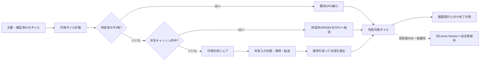

# コールド表示と低倍率描画の改善設計

状態: **通常ラスタの可視ジョブ共通化・中央優先・中断可能なコールド描画とC2/C3診断を実装**（2026-10-24）。[実装結果と未実装範囲](verification/COLD-RENDERING-RESULTS-2026-10-24.md)を参照。派生ディスクキャッシュとM5のジョブ化は未実装。対象は、先読み済み親タイルがない初回表示、急なズーム、GPUキャッシュ消失、Worker再起動後の完全描画。既存の[合成ピラミッド設計](LOW-ZOOM-COMPOSITE-PYRAMID-DESIGN.md)と[中断可能な先読み設計](RESUMABLE-LOW-ZOOM-PREFETCH-DESIGN.md)の次段階にあたる。実装済み範囲は[2026-10-23の結果](verification/RESUMABLE-LOW-ZOOM-PREFETCH-RESULTS-2026-10-23.md)で確認する。

## 1. 事実と未測定事項

| 条件 | 現時点の根拠 | 読み方 |
| --- | --- | --- |
| 20層・DPR 2・物理倍率0.5、120フレームのパン直後 | 現行WASMの5回測定でB2 1.8–3.5 ms、ズーム前の親35/35、B1 p95 3.3–4.2 ms、B3 p95 10.4–20.7 ms | **先読み成功時**の値。コールド性能ではない。[結果](verification/RESUMABLE-LOW-ZOOM-PREFETCH-RESULTS-2026-10-23.md) |
| 同条件のWorker再起動と初回完全描画 | 現行WASMのB7 1391.0–1421.2 ms | 起動・ジャーナル復旧・初回描画の合計。描画単独の値ではない。[結果](verification/RESUMABLE-LOW-ZOOM-PREFETCH-RESULTS-2026-10-23.md) |
| 親がない低倍率表示 | **現行WASMの反復測定なし** | 旧実装の1回測定は428.8 ms、1960回・513.8 MB転送、`commandsMs` 304.7 ms。現行の予測値に転用しない。[旧測定](verification/dpr2-same-physical-zoom-2026-10-22.json) |
| メモリ | 現行測定はGPU計上値484.75/512 MiB、WASM 241.06–241.56/1024 MiB | GPU計上値は内部ステージングや実VRAM量の完全な測定ではない。[結果](verification/RESUMABLE-LOW-ZOOM-PREFETCH-RESULTS-2026-10-23.md) |

現行の`Renderer::render`は可視キーを列挙し、欠けたキーごとに`compose()`を同期実行する。時間予算を超えても最初の1枚は完了させる。ラスタの`compose()`は完成済み子4枚があれば`downsample_cached()`を使うが、子が欠けると`commands()`から元タイルを取得・転送する。`prefetch_step()`は短いジョブに分割済みだが、可視描画には使われない。したがって、先読みの成功と初回表示の応答性は別問題である。[Renderer](crates/alto-gpu/src/renderer.rs)、[Worker](packages/alto-sdk/src/worker.js)。

## 2. 守る契約と成功の定義

1. **完成表示は従来の直接合成と同じ画素**にする。透明端、半透明、合成順、孤立グループ、回転、非整数倍率を含める。前フレームや粗いレベルの画像を暫定表示する場合は`preview`として区別し、`pending=0`、B2/B7、画素比較の完成条件に数えない。
2. 文書、タイルストア、確定済みOPFSジャーナルが正本。GPUタイルと後述のディスク表示キャッシュは破棄可能な派生物。元タイルの破損を透明に置き換えず、既存の`get_checked`エラーを伝播させる。外部`.alto`の厳格な検証と保存障害UIを変えない。
3. 可視描画と編集入力を先読みより優先する。可視ジョブも1回のWorker呼出しで無制限に走らせない。JavaScriptのWorkerタスクは実行中に入力メッセージで割り込まれないため、分割点を明示する。[MDN JavaScript execution model](https://developer.mozilla.org/en-US/docs/Web/JavaScript/Reference/Execution_model)。
4. 現行の256表示スロット、最大512入力アトラススロット、GPU推定512 MiB、WASM 1024 MiBを維持する。追加の恒久GPUテクスチャを初期案に含めない。
5. GPUへの`submit`はGPU完了ではない。`queue.write_texture`の転送は次の`submit`で実行が始まる。完全描画のベンチは最終提出後の`gpuIdle()`まで測り、個別パスのGPU時間が必要なら対応デバイスだけtimestamp queryを使う。[wgpu 30 Queue](https://docs.rs/wgpu/30.0.1/wgpu/struct.Queue.html)、[wgpu 30 FeaturesWebGPU](https://docs.rs/wgpu/30.0.1/wgpu/struct.FeaturesWebGPU.html)。

## 3. 目標構成

`FramePlanner`が1つのviewportに必要な表示キー、レベル、優先順位、現在のscene世代を確定する。優先順位は「現画面の未完成タイル → 復旧直後の可視域 → 将来の親先読み」。可視キーは画面中央から距離順に処理し、同距離なら座標順として再現性を持たせる。これは**最初の有意味な表示**を早める方針であり、完全描画のタイル総数を減らすものではない。sceneが変われば古い未提出ジョブを捨て、交差するGPU表示項目を無効化する。

### A. まず既存の完成済み子を使う

各可視親で`downsample_cached()`を最初に試す。子が一部だけある場合に不足子を作るか、親を直接合成するかは計測値で選ぶ。子を作る場合は4枚の合成と縮小の合計費用を比較し、**「子が1枚あるから常に有利」とは決めない**。既存scratchは直列利用し、透明化は実装済みのレンダーパス`LoadOp::Clear`を維持する。WebGPU経路で未実装だった`clear_texture`へ戻さない。[Renderer](crates/alto-gpu/src/renderer.rs)。

### B. キャッシュミスを短い可視ジョブへ変える

ラスタ通常合成について、現行の先読み`PrefetchJob`の「計画位置を保存 → 固有入力を短い単位で準備 → スロット再解決 → 提出後に登録」という構造を、可視ジョブにも共有する。現行`commands()`のシーン走査と取得・アップロードの結合を分ける。状態は`Plan → Inputs → Resolve → Submit → Ready`とし、1ステップ後にWorkerの入力キューへ戻る。1件の`get_checked`、変換、転送、GPU提出はそれぞれ原子操作なので、その最長時間を計測する。2 msは初期の**目標ステップ**であって厳密な保証ではない。現行先読みの最大ステップも2.1–2.3 msだった。

`Plan`はシーン更新時に保持するタイル索引を参照し、タイルごとの全`BTreeMap`再構築を避ける。1可視フレーム内で入力ハッシュを重複除去し、アトラス容量を超えない小バッチを作る。ただしコマンドのレイヤー順、opaque判定、グループ境界は現行と同じにする。`Inputs`は`get_checked`で検証されたタイルを取得し、RGBAは既に借用する現行`rgba_pixels()`を維持する。したがって旧設計の「RGBAの不要コピーを除く」は**既に実装済み**であり、再実装しない。[Renderer](crates/alto-gpu/src/renderer.rs)。

`Resolve`では長期保持したアトラスのスロット番号を信用せず、直前にハッシュから引き直す。計画と提出の間に可視処理が退避した入力だけ再準備する。提出までの入力スロットと表示先スロットの寿命を保護し、後続コマンドの書込みが先の読取りを壊さないことをGPUキュー順序と画素試験で確認する。表示キャッシュへの登録は必要入力が揃い、合成コマンドを正常に提出した後だけ。GPU完了前に同一スロットを再利用する場合もキュー順序を明示的に管理する。ジョブ取消時は未提出の出力を公開しない。

M5のマスク、効果、調整、テキスト、メッシュやストローク中プレビューは、最初の段階では現行`compose_m5`/直接合成へ戻す。通常合成と同等のピクセル試験を通した機能から段階的に共通ジョブへ移す。レイヤーごとの縮小画像を完成結果の代用にしない。アルファ合成と縮小の順序は一般に交換できず、最終合成後の親と画素が変わり得るためである。

### C. 再起動・再オープン向けの破棄可能な派生キャッシュ

初めて開く文書には使えない。**一度完成した安定版の最終合成タイル**だけを、編集入力のない時間にOPFS内の別領域へ保存する。候補は直近の可視域と隣接する低倍率親に限定し、文書全体を先に焼かない。キーは`document_id / snapshot_hash / render_algorithm_version / pixel_format+color_rule / level / x / y`。最初は編集のたびに該当snapshotの全派生項目を不適格とし、領域別無効化は後続の最適化とする。キャッシュにはヘッダー、長さ、内容ハッシュを持たせ、読み込み時に検査してからGPUへ転送する。書込み途中の項目は有効一覧に載せず、クラッシュ後の不完全ファイルは無視する。

OPFSは容量制限・削除の対象であり、派生キャッシュを復旧の正本にしてはいけない。[WHATWG Storage Standard](https://storage.spec.whatwg.org/)。`navigator.storage.estimate()`を参考に上限を設け、容量不足時は派生物から削除し、キャッシュ保存を停止する。正本ジャーナルと別のパス・予算・失敗処理にし、キャッシュの書込み失敗を文書保存の失敗として報告しない。同期OPFSアクセスを使う場合はWorker専用なので、Engine WorkerやジャーナルのStorage Workerを長時間ブロックしない**専用Cache Worker**で処理する。[Chrome File System Access API](https://developer.chrome.com/docs/capabilities/web-apis/file-system-access)。キャッシュ読込み自体が遅い場合は待たずに直接合成へ戻す。

完成RGBAの保存にはGPUからCPUへの読戻しが必要である。既存表示テクスチャを使用した読戻しが可能かを確認し、必要なら`COPY_SRC`使用条件を加える。キュー完了後に1枚ずつステージングバッファへコピーして非同期mapし、Map完了後にCache Workerへ転送する。読戻し待ちで可視描画やジャーナル書込みを止めない。256px幅RGBAの1行は1024 bytesでコピー行ピッチの256 bytes境界を満たすが、別サイズの将来拡張では再計算する。読戻し用バッファは同時1枚・約256 KiBを初期上限とし、計上済みGPU余裕と実測を確認する。読戻し・圧縮・書込みの累計CPU/GPU時間が再オープンの節約を上回るなら、このキャッシュは採用しない。読み込み時はCache Workerが検証済みRGBAを返し、Engine Workerが現行表示スロットへ転送する。読込み結果に対応するscene世代が変わった場合は破棄し、直接合成との競走で二重登録しない。

256×256 RGBAの完成タイル1枚は262,144 bytes。35枚なら非圧縮8.75 MiBという容量の算術上限であり、旧測定の513.8 MBの元タイル転送より小さい。ただしOPFS読込・検証・GPU転送・GPU処理の実時間が未知なので、速度向上の見積りには使わない。新規文書の最初のコールド表示はBの経路で処理する。

## 4. 測定計画と採否ゲート

同一のChrome 155/Metal環境、3840×2160・半透明20層、1093×827 CSS/DPR 2、1566×1284物理キャンバスで各条件を独立プロファイル5回以上測る。標準B1/B2/B3/B7を残したまま、次を追加する。計測用フックで対象キャッシュを明示的に空にし、先読みを止めてから要求を発行する。文書作成中に偶然できた表示タイルをC1に残さない。フックは製品APIへ露出しない。SwiftShaderは画素・機能・故障注入の回帰用とし、Metalの性能値に代えない。

| ID | 準備条件 | 完了条件 |
| --- | --- | --- |
| C1 初回コールド | 新規文書、対象低倍率へ直行。GPU表示/アトラスも派生ディスクキャッシュも空 | 要求から全可視タイル提出後の`gpuIdle()`まで。最初の有意味な提示時間も別記録 |
| C2 GPUだけコールド | 同一文書のGPU表示/アトラスを診断フックで破棄。CPUタイルキャッシュは保持 | C1と同じ。CPU取得/展開との差を出す |
| C3 CPU・GPUコールド | CPUデコードキャッシュとGPUキャッシュを破棄。正本は保持 | C1と同じ。`get_checked`の寄与を見る |
| C4 復旧コールド | Worker再起動、ジャーナル復旧。派生キャッシュを無効化/有効化で各測定 | 起動、復旧、初回提示、全可視GPU完了を別計時。B7とも比較 |
| C5 外部ファイル | 新規プロファイルで同一`.alto`を開く。派生キャッシュなし | 外部ZIP全検証、初回提示、GPU完了を別計時。復旧高速経路と混同しない |
| C6 故障・変化 | 派生物欠損/破損/容量不足、編集・Undo/Redo・回転・ズーム連打・GPU喪失 | 正本との画素一致、正しいエラー、古いタイル非表示、再計算への復帰 |

記録する内訳は、可視タイル数/レベル、完成済み子命中と失敗理由、固有元タイル数と重複率、CPUキャッシュhit/missと展開/ハッシュ検証、アトラスhit/退避、転送回数/bytes、計画/取得/転送/提出のCPU時間と**最大単一ステップ**、派生キャッシュhit/missと読戻し・I/O・検証、Worker復旧各段階、`gpuIdle()`待ち、GPU推定/WASMメモリである。CPU内訳は重なり得るので単純加算しない。GPUの純実行時間はtimestamp queryが使える場合だけ別列にし、なければ「未測定」と記す。[wgpu 30 FeaturesWebGPU](https://docs.rs/wgpu/30.0.1/wgpu/struct.FeaturesWebGPU.html)。計測有効/無効の差も確認する。

採否は順番に決める。P0でC1の支配項が計画・重複取得なら索引と共有バッチを先に試す。展開/検証ならCPUキャッシュの命中・容量を調べる。GPU実行/転送が支配的なら提出単位とアトラス退避を調べる。C4の派生キャッシュ命中が実際に復旧時間を縮め、I/O・容量・編集時失効が妥当な場合だけCを有効化する。未測定のまま全段階を必須実装とはしない。

**既存の合格線:** B1 p95 ≤16.7 ms、ウォームB2 ≤250 ms、B3 p95 ≤33.4 ms、B7 ≤1500 ms、GPU計上値≤512 MiB、WASM≤1024 MiBを維持する。コールドC1–C5はまず現行版の5回分布を確定する。改善案の採用には同一条件で中央値・各回・p95、最大同期ステップ、転送量、画素差を対照比較する。C1の完全表示≤250 msは**最終的な希望値**として記録するが、現在値が未測定のため達成を約束しない。早期プレビューの時間で代用しない。

## 5. 実装単位

| 段階 | 主な場所 | 成果と止める条件 |
| --- | --- | --- |
| P0 診断 | `crates/alto-gpu/src/renderer.rs`、`crates/alto-wasm/src/lib.rs`、`packages/alto-sdk/src/worker.js`、`tests/e2e/browser-tests.js` | C1–C5の現在値、段階別時刻、単一ステップ最長を記録。ここでボトルネックを確定する |
| P1 索引とジョブ共通化 | `crates/alto-gpu/src/renderer.rs`とscene構築箇所 | 可視と先読みが同じラスタ計画器を使う。既存画素とB1/B3、メモリを保つ。M5は現行経路 |
| P2 コールド可視処理 | Renderer、WASMの進捗API、Workerの`tick`処理 | 中断可能な可視ジョブ、入力共有、中央優先、完成/previewの区別。C1–C3のCPU停止時間と完全描画を比較 |
| P3 派生ディスクキャッシュ | 新規Cache Worker、SDK、必要ならRendererの完成RGBA出力 | C4で命中時の短縮を実測。容量不足・破損・ジャーナル障害から独立して安全に戻る |
| P4 対象拡大 | M5描画経路と画素試験 | 機能ごとに直接合成との一致を証明してから共通ジョブへ移す |

P0後に、コールドの律速が本当にP1/P2で減るかを判定する。P3は保存済み文書にだけ効く追加案であり、新規文書C1の改善とは別に評価する。各段階を機能フラグで切替可能にし、性能退行・GPUメモリ超過・古い画素の採用があれば直前の経路へ戻す。上表は段階計画。現在の実装範囲と配布WASMは冒頭の結果報告で確認する。

## 外部資料

- [wgpu 30.0.1 `Queue`](https://docs.rs/wgpu/30.0.1/wgpu/struct.Queue.html): 転送の提出タイミング、`on_submitted_work_done`、テクスチャ書込みの代替手段。
- [wgpu 30.0.1 `FeaturesWebGPU`](https://docs.rs/wgpu/30.0.1/wgpu/struct.FeaturesWebGPU.html): WebGPUの任意機能としてのtimestamp query。
- [Chrome File System Access API](https://developer.chrome.com/docs/capabilities/web-apis/file-system-access): OPFS同期アクセスはWorkerで利用。
- [WHATWG Storage Standard](https://storage.spec.whatwg.org/): ストレージの容量見積り、圧迫時の削除、永続性。
- [MDN JavaScript execution model](https://developer.mozilla.org/en-US/docs/Web/JavaScript/Reference/Execution_model): Workerを含むJavaScriptタスクの実行単位。

外部資料はWebプラットフォームの制約を確認するために使った。優先順位、ジョブ境界、採用ゲート、性能目標はAltoのコードと実測に基づく本設計の提案である。
