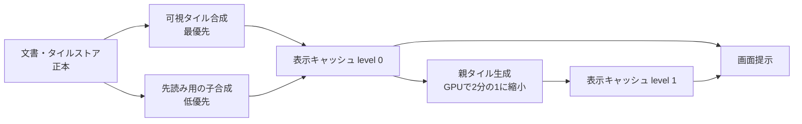

# 低倍率表示の合成タイル階層と先読み設計

状態: **設計のみ。未実装、性能改善も未検証。** 2026-10-22 の[DPR別実測](verification/DPR-WORKER-RESILIENCE-RESULTS-2026-10-22.md)で残った「DPR 2、物理倍率0.5」のB2を対象にする。既存の[DPR・Worker設計](DPR-WORKER-RESILIENCE-DESIGN.md)のD1を、この広い可視範囲の条件に対して具体化する。Worker復旧のR1、文書形式、保存契約は変更しない。

## 1. 解く問題と測定上の境界

3840×2160、半透明ラスタ20層、1566×1284物理ピクセル、物理倍率0.5では可視文書が3132×2568になる。B2のGPU完了までが428.8 ms（目標250 ms）、入力タイルのアップロードが1,960回・513.8 MB、`commandsMs`が304.7 ms、`getMs`が161.9 ms、`writeMs`が129.4 ms、`pyramidHits`が6だった。GPU推定は483.75/512 MiB、WASMは241.44/1024 MiB。これは**1回の測定**であり、時間内訳は重なるため足し算しない。[生データ](verification/dpr2-same-physical-zoom-2026-10-22.json)。

同じCSS上の見た目でDPR 2を測るとB2は104.7 ms、可視文書は1566×1284だった。したがって今回の主題はDPR単体の遅さではなく、**一度に広い文書領域を表示する際の入力タイル取得・転送・合成の重複**である。現行`Renderer::downsample_cached`は完成済みの子合成タイルがそろったときだけ親を作る。`compose`は子が欠ければ20層の元タイルを直接取得・転送し、M5機能のあるsceneでは縮小経路を使わない。[Renderer](crates/alto-gpu/src/renderer.rs)。

設計仮説は「編集や通常表示の空き時間に、次の1段階の縮小表示で使う完成済み合成タイルを用意し、ズーム操作時の元タイル再転送を減らす」。親1枚は最終合成済みの子4枚から生成するため、ズーム時に元の20層を再合成する必要がない。ただし、親を作る前の仕事は消えず、時間的に前倒しするだけである。空き時間のないコールド表示まで250 msに収まるとは、この段階では主張しない。

## 2. 所有権とデータの流れ

- 正本は文書とタイルストア。GPUアトラス、合成表示タイル、縮小親はすべて破棄可能な派生物とする。`.alto`とOPFSジャーナルの正本形式は変えない。
- 第一段階はラスタ、通常合成、半透明のsceneに限り、現行`downsample_cached`と同じ演算・色空間・端の透明パディングを使う。マスク、効果、調整、テキスト、メッシュなど現行`compose_m5`に進むsceneは直接合成にフォールバックする。対象拡大は画素比較後に別判断とする。
- 現行`CacheKey = (level, x, y)`は座標索引として残す。キャッシュ項目に`origin`（visible/prefetch）、`last_used`、`job_epoch`を持たせる。文書更新時はジョブ世代を進め、`invalidate(bounds)`で交差する全レベルの項目を消す。交差しない既存項目は再利用できるが、古い世代の進行中ジョブは登録しない。
- Worker再生成・GPUデバイス再作成ではGPU世代を進め、GPU派生物と先読みキューをすべて捨てる。復旧済み文書から可視タイルを作り直す。

## 3. 候補の選び方と優先順位

`Renderer::render`が実際に使う物理倍率とキャンバスサイズから、現在の可視集合を先に確定する。低倍率への準備では、**現在の倍率の半分**にした場合に見える文書矩形を同じ中心・回転で計算し、その1段粗いレベルの親タイルだけを候補にする。範囲は文書境界で切り、現在の可視域に近い順、その次に外周へ広げる。ズーム方向を無制限に予測しない。画面の移動・倍率・回転・サイズが変われば候補を作り直す。

Workerの仕事は次の順序にする。

1. 編集、Undo/Redo、保存・復旧、resize、viewport要求を処理する。
2. 必要な**可視**タイルを完成させ、提示する。可視タイルが`pending > 0`なら先読みを始めない。
3. 直近の入力が落ち着き、未処理メッセージがないときだけ先読みを1ステップ実行し、イベントループへ戻る。初期値は「最後の入力から100 ms」「1ステップの目安2～4 ms」。実測で調整する。
4. 親の子が全部キャッシュ済みなら縮小して親を登録する。欠けていれば、低優先の子合成ジョブを**1枚ずつ**進める。親が完成した後は、他に必要とされない子を退避可能にする。先読み対象の上限は予測した可視親の枚数と空きスロットから動的に決める。今回の画面で必要な親を途中で打ち切る固定32枚などは、B2改善を妨げるので採用しない。

現行`runtime.tick(8)`と`Renderer::compose`は同期呼び出しであり、1枚の合成が8 msを超えても途中で入力へ道を譲れない。**単に先読みループへ時間判定を付ける実装は不可**。まず`commands()`内の取得・アップロード・合成準備を再開可能な単位に分け、各ステップ後にWorkerが`queue`、`pendingViewport`、`pendingResize`を確認できるようにする。GPUへの提出と表示キャッシュ登録は、必要な入力とコマンドがそろった時点でのみ行う。途中成果は公開しない。個々の`get_checked`またはGPU提出そのものが遅い場合はその最長時間を計測し、さらに分割できない限り先読みを有効化しない。`setTimeout(0)`などでステップ間にメッセージ処理機会を作る。

`waitFrame`は測定・明示待機用であり、先読みをその完了条件に含めない。B2はズーム要求後の**完全描画とGPU完了**で測り、未完成プレビューを成功に数えない。

### ジョブの状態

`queued → preparing-child → child-ready → composing-parent → ready`。各遷移前に`scene_epoch`、`gpu_epoch`、`viewport_seq`を照合する。編集、ズーム・パン、resize、Worker/GPU障害で不一致になれば`cancelled`にし、未公開の中間資源を解放する。文書の範囲更新では既存の有効なキャッシュまで全消去せず、交差項目だけを無効化する。GPUコマンドが参照中の子スロットは、そのキュー順序と寿命が安全と確認されるまで再利用しない。

## 4. 256表示スロットと512 MiB予算

現行の表示キャッシュは256枚固定、アトラスは最大512枚である。まず配列容量を増やさず、用途別の退避規則だけを変更する。

1. そのフレームで必要な可視集合を**合成開始前**に保護する。現在は`used`更新が合成後なので、生成途中に別の可視タイルがLRU退避され得る。
2. 親を作る間は、その子4枚と親の書込み先を保護する。空きがなければ先読みをスキップし、可視処理を犠牲にしない。
3. 退避は「古い世代の先読み → 非可視の先読み → 非可視の通常キャッシュ」の順。可視集合はフレーム終了まで退避しない。可視だけで256枚を超える場合は現行の容量エラーを維持する。
4. 親が完成した後、先読みだけの子は次の親候補に使わない限り優先退避する。これにより一時的な子＋親の同時保持を短くする。

`downsample_cached`が現在生成する512×512 RGBA一時テクスチャは約1 MiBである。再利用するなら**1枚のscratchを直列で使う**設計とし、同時実行数、コマンド提出後の寿命、GPU喪失時の破棄を明示する。`FrameReport.gpu_bytes`の固定配列推定だけで余裕を判断せず、scratch、WGPU内部のステージング、未完了の一時資源を別に記録する。483.75/512 MiBという既存測定から、追加GPU配列や転送バッファの恒久確保を初期案に含めない。

## 5. コールド表示を別に扱う

空き時間の先読みは、生成直後・再読込直後・急なズームで親がまだないと効かない。そこで同じB2手順を`warm`（先読み機会あり）と`cold`（親なし）に分けて測る。標準B2がどちらに近いかも記録する。

ウォームB2が改善してもコールドB2が250 msを超えるなら、次の追加設計を比較する。

- 保存確定時またはその後の空き時間に、文書全体あるいは最近の表示範囲の**完成済み合成親タイル**を派生キャッシュとして作る。
- OPFSの正本とは別の、削除可能な領域へ保存する。キーは文書ID、確定リビジョンまたは内容指紋、描画アルゴリズム版、色・縮小方式、level/x/yとし、内容検証に失敗した項目は捨てて正本から再描画する。未確定編集の表示に古い項目を使わない。編集後はまず全派生キャッシュを無効化する単純な実装から始め、部分無効化は検証後に限る。
- ディスク容量と読込時間を測り、再オープンB5、Worker復旧B7、保存障害時の動作を回帰させない。派生キャッシュを書けなくても保存成功/失敗の判定は変えない。

これは第二段階の候補であり、OPFS保存・ローダー実装を現時点で採用したという意味ではない。コールドでも即時達成が必要なら、先読みだけでは足りないという判断材料を残す。

## 6. 計測、受入条件、段階

| 段階 | 変更対象 | 判定材料 |
| --- | --- | --- |
| P0 計測 | `renderer.rs`、`worker.js`、B2記録 | レベル別の可視枚数・命中/欠損、縮小失敗理由、ユニーク元タイル数、取得/書込/合成、先読み時間と中断回数、最大同期ステップ、GPU完了、メモリ内訳を5回以上記録する。 |
| P1 安全な退避 | `Renderer::render/compose` | 可視集合と子の保護を先に実装。画素・入力遅延・GPU予算が維持される。 |
| P2 分割先読み | `renderer.rs`、WASM境界、`worker.js` | ラスタ対象で親候補・子生成を小刻みに実行。ウォームB2の転送量と時間が下がり、B3が悪化しない。 |
| P3 コールド対策の判断 | 派生OPFSキャッシュ、または元タイル取得経路 | P2後のコールド内訳で必要と分かった場合だけ着手する。 |

**合格条件:** 同じ実機・ブラウザ・入力文書でDPR 2/物理倍率0.5のB2 GPU完了時間を250 ms以下へ戻し、5回以上の個別値と中央値を残す。既存B1 ≤16.7 ms、B3入力からGPU完了までのp95 ≤33.4 ms、B7 ≤1500 ms、GPU ≤512 MiB、WASM ≤1024 MiBを維持する。ウォームだけが合格なら「ウォームのみ」と報告し、コールドを完了扱いにしない。SwiftShaderのCIは機能・画素・障害試験とし、Metalの性能合格の代用にしない。

画素試験は直接合成と親縮小を、透明端、半透明20層、通常合成、タイル境界、非整数ズーム・回転で比較する。縮小方式そのものの差が既存表示にある場合は、許容差を先に定義し、同一入力に対する再現性を示す。編集・Undo/Redo・別版へ復帰・ズーム連打・長いペンストローク・保存中・Worker/GPU復旧で古い親が一瞬でも表示されないことを確認する。M5対象外sceneは従来の画素と時間を比較し、黙って近似しない。

入力の`atlasHits=0`と513.8 MB転送を踏まえ、`Queue::write_texture`をバッチ/ステージングへ置き換えるのはP2後の残差を見て判断する。API変更だけでは元タイル数は減らない。[wgpu Queue](https://docs.rs/wgpu/30.0.1/wgpu/struct.Queue.html)はバッファ経由のコピーやcomputeを代替として示すが、Altoで速いかどうかは比較測定が必要である。[GEGLのタイル・mipmap・部分グラフキャッシュ](https://gegl.org/features.html)は派生表示を再利用する方向の参考であり、上記の優先順位・容量・ジョブ境界はAlto固有の設計仮説である。
