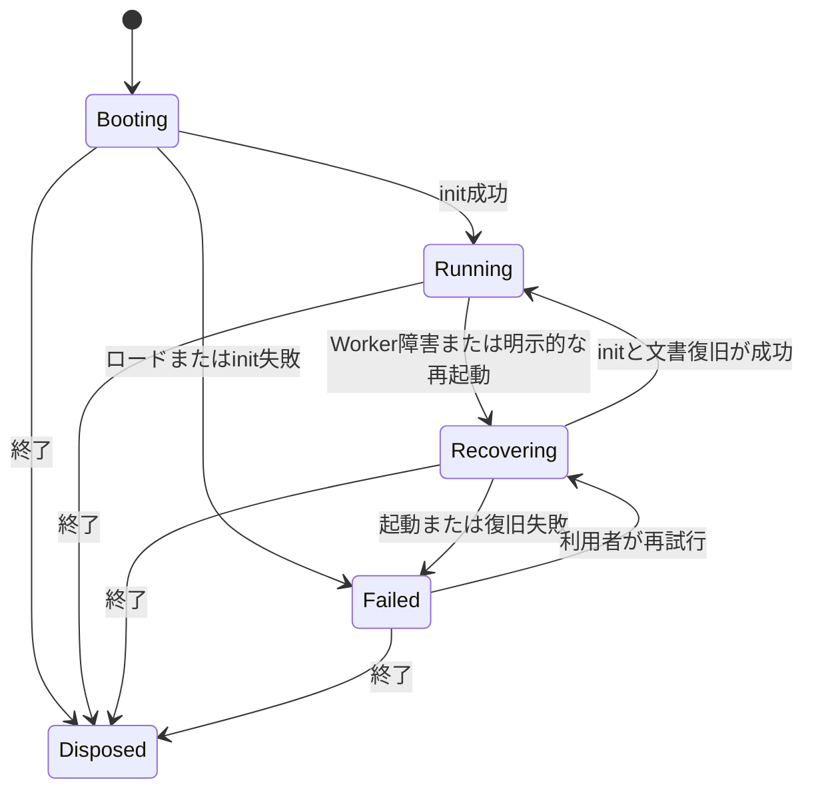

# 高DPI表示とWorker障害復旧の設計

状態: D0の比較条件とR1のWorker状態・再試行を実装。同じ文書範囲でのDPR 2測定がB2目標を満たしたためD2の転送変更は保留した。**より広い文書範囲を表示するDPR 2・物理倍率0.5の未達には、[低倍率合成タイル階層設計](LOW-ZOOM-COMPOSITE-PYRAMID-DESIGN.md)の可視タイル保護と親タイル先読みを実装した。**[先読みの結果](../verification/LOW-ZOOM-PREFETCH-RESULTS-2026-10-23.md)を参照。分割ジョブと網羅的な障害注入は未実装。以前の[追加実装結果](../verification/DPR-WORKER-RESILIENCE-RESULTS-2026-10-22.md)と[縮小表示・復旧高速化設計](PERFORMANCE-RECOVERY-DESIGN.md)は当時の判断を記録している。以下には当初の設計案も含まれ、実装内容との差は各結果報告で示す。

## 1. 判断の根拠と未確定な点

| 観測済み | 解釈と限界 |
| --- | --- |
| 同じCSS表示サイズ・同じ数値の`viewport.zoom`で、B2はDPR 1が約206 ms、DPR 2が約436 ms。DPR 2では1,960回、約514 MBのアップロード。 | 高DPI条件で現行B2目標250 msを超える。ただし`zoom`は**物理ピクセル/文書ピクセル**であり、DPRだけを変えると表示する文書の範囲も変わる。純粋な高DPIコストと断定しない。比較可能な再測定が先。 |
| DPR 2のB2プロファイルでは`get_ms`約166 ms、`write_ms`約129 ms、`commands_ms`約313 ms。 | CPU側のタイル取得と転送が優先調査対象。GPU実行時間とは別の計時であり、合計を厳密なクリティカルパスとして扱わない。 |
| `Renderer::downsample_cached`は必要な子表示タイルが1つでも欠けると使用できない。表示キャッシュは256スロット、アトラスは最大512スロット、20層ベンチのGPU推定使用量は約484/512 MiB。 | 親タイルを保持する余地と退避順を測る。アトラスや表示キャッシュを単純に増やす方針は採らない。 |
| 以前のB7で`{"error":"undefined"}`が出た。Workerスクリプト404の最小再現で同じ文字列を確認し、サーバー再起動後の新しいページではB7が通った。 | 当時の個別の失敗ファイルは記録されていない。サーバー停止・古いタブが最も整合するが確定原因とは呼ばない。継続的な性能問題とWorker読み込み障害を分ける。 |

現行SDKの`resize()`はCSS寸法に最大2のDPRを掛け、`screenToDocument()`も同じ係数を使う。`viewport.zoom`をそのままWorkerへ送り、Rendererは物理キャンバス幅を`zoom`で割って可視文書範囲を決める。[SDK](../../packages/alto-sdk/src/index.ts)、[Renderer](../../crates/alto-gpu/src/renderer.rs)、[B2](../../tests/e2e/browser-tests.js)。この単位は正しく比較するための設計上の前提である。

## 2. 守る契約

1. 文書・OPFSジャーナル・公開`.alto`形式を今回の表示最適化で変えない。既存V2復旧の全体ハッシュ検証、前世代フォールバック、タイル使用時の内容検証を維持する。
2. 高速表示のために半透明、ブレンド、マスク、効果、テキストの画素を黙って近似しない。プレビューが必要なら「未完成」として区別し、B2はGPU完了後の完全描画で測る。
3. 既存のGPU推定512 MiB上限とWASM 1024 MiB上限を維持する。キャッシュの容量・一時テクスチャも予算へ算入する。
4. Workerの起動・復旧が終わるまで編集と保存を受け付けない。失敗を保存データの破損と誤表示せず、復旧成功通知を先に出さない。
5. 保存が確認されたジャーナルだけを自動復旧の根拠とする。クラッシュ時に未確定だった操作を復旧済みと表示しない。

## 3. ズーム単位と測定契約

公開`viewport.zoom`の意味は現行の「物理ピクセル/文書ピクセル」を当面維持し、既存呼出しを壊さない。SDK内部に`effectiveDpr = min(devicePixelRatio || 1, 2)`を1か所で保持し、UI向けに`cssZoom = physicalZoom / effectiveDpr`という明示的な読み書き補助を追加する設計とする。`fit()`、ポインター座標変換、DPR変更時の表示倍率維持は同じ`effectiveDpr`を参照する。`devicePixelRatio`が変わった場合は、文書中心と`cssZoom`を維持して`physicalZoom = cssZoom × newEffectiveDpr`に更新する。既存の数値APIの意味を変える移行は別の版として扱う。

ベンチマークは次の2条件を**別名**で保存する。

| 条件 | 設定 | 目的 |
| --- | --- | --- |
| 同じ見た目 | CSS表示サイズと`cssZoom`を固定し、DPRごとに`physicalZoom = cssZoom × effectiveDpr`を設定 | Retina化による実際の追加コストを評価する。DPR 1・2で文書の可視範囲と中心が一致することを座標で検証する。 |
| 同じ数値 | CSS表示サイズと既存`physicalZoom`を固定 | 現行B2との継続比較と、広い文書範囲を描く容量試験。DPR 2の436 msはこの条件の観測値。 |

両方でキャンバスのCSS寸法、実ピクセル寸法、DPR、実効ズーム、可視文書矩形、GPUアダプター、ブラウザ版、メモリ予算、ウォーム/コールド状態をJSONに残す。各ランでアップロード回数・バイト、アトラス命中/退避、表示タイル命中/退避、縮小命中/失敗理由、CPU段階時間、GPU完了までの時間を記録する。時間は独立した新規プロファイルで複数回取り、各ランと中央値を保存する。UIが最初に応答する時刻と完全描画時刻も分ける。CSSピクセルと実ピクセルを別々に記録する根拠は[Chromeチームの高DPI解説](https://web.dev/articles/device-pixel-content-box)にある。

## 4. 表示キャッシュの設計

### 4.1 対象と所有者

文書本体はCPU/保存側が所有し、`Renderer`のアトラスと合成表示タイルは破棄可能なGPUキャッシュとする。現在の`CacheKey = (level, x, y)`、`invalidate(bounds)`による空間的な無効化を基礎にする。縮小キャッシュは**完成した合成表示タイル**から生成し、レイヤーの順序・半透明の意味を変えない。現行`compose_m5`経路に入る効果・テキスト等は、画素同等性を個別に証明するまで先読み・縮小生成の対象外とする。

### 4.2 可視タイルと先読みタイル

`Renderer::render`はまず必要な可視タイルを確定し、そのスロットをその描画サイクルの間は退避対象から外す。既存の256表示スロット内で、残りの容量だけを先読みに使う。当初の上限案`min(32, 256 - visible_count)`は広い可視範囲の未達条件に十分とは限らないため、[低倍率設計](LOW-ZOOM-COMPOSITE-PYRAMID-DESIGN.md)では必要な親の枚数と空きスロットから動的に決める。退避優先順位は「期限切れの先読み → 非可視の先読み → 非可視の通常タイル」。可視タイルの生成が256スロットを超える場合は、現行の容量エラーを維持する。

操作が落ち着いてWorkerに余裕があるとき、現在の表示レベルの**一段粗い親タイル**だけを候補にする。キャンバス内で必要な子合成タイルがすべてそろっている親は既存のGPU縮小経路で作る。子が欠けている親を先読みするために大量のレイヤータイルを同期ロードしない。**ただし広い可視範囲でB2が未達だった条件については、新しい[低倍率設計](LOW-ZOOM-COMPOSITE-PYRAMID-DESIGN.md)が、入力に道を譲る分割ジョブで不足する子を生成する方針を追加する。**ズーム要求時に親がなければ従来の直接合成へ戻す。先読みは可視タイル・ペン入力・保存処理より低い優先度とし、入力、文書変更、GPU喪失で即停止する。

先読みジョブは生成時の`job_epoch`を保持する。文書変更・GPU再生成時にepochを進め、古いジョブの生成結果はキャッシュへ登録しない。既存キャッシュは`invalidate(bounds)`で関係する座標だけを消す。これにより、無関係なタイルは残しつつ、非同期の古い結果は採用しない。GPUコマンド提出後のスロット再利用は、キュー上の読み取りが完了または順序保証で安全と確認できるまで行わない。

GPUの縮小用scratchテクスチャは毎回新規確保せず、必要時に再利用する候補とする。サイズと寿命をGPU予算に明示し、GPU喪失時にはキャッシュとともに作り直す。

### 4.3 段階的な判断

1. **計測のみ**: 同じ見た目のDPR比較と、キャッシュミス・退避理由を追加する。ここで根本原因の優先順位を更新する。
2. **退避規則**: 可視タイルを保護し、縮小親の小さな先読み枠を設ける。画素、入力遅延、GPU使用量、ウォームズームを比較する。
3. **必要なら入力タイル共有**: コールドズームでもアップロードが支配的なら、既存設計書のP5バッチ化を採用する。1バッチ内で同じ内容ハッシュを一度だけ転送し、参照中のアトラススロットを固定する。複雑な`compose_m5`経路は当初は既存処理に残す。
4. **必要なら転送方式比較**: 転送量と回数を減らしても`write_ms`が支配的な場合に限り、`write_texture`と再利用可能なステージングバッファを同じ負荷で比較する。API置換だけで改善すると仮定しない。

GEGLは必要時のタイルmipmapと部分領域・サブグラフのキャッシュを採用し、Kritaは表示領域と空き時間のキャッシュ生成を使う。ここでの親タイル先読み、枠数、退避規則は**Altoへの設計上の推論**であり、それらの製品が同じ実装をしているという主張ではない。wgpuの資料はアトラス/配列の利用と、アップロード量によってはステージングを比較する方針を示す。[資料1](https://www.gegl.org/features.html)、[資料2](https://docs.krita.org/en/reference_manual/preferences/performance_settings.html)、[資料3](https://wgpu.rs/doc/wgpu/documentation/best_practices/dos_and_donts/index.html)、[資料4](https://wgpu.rs/doc/wgpu/struct.Queue.html)。

## 5. Worker復旧の設計

### 5.1 明示的な状態

`AltoEngine`に`Booting | Running | Recovering | Failed | Disposed`を持たせる。保存障害の`storageFailure`は別に維持し、Workerのロード障害やクラッシュを`engineFailure`として分ける。GPUデバイス喪失はWorker内のGPU再作成経路を優先し、Worker全体の再起動とは別イベントにする。WebGPUの`device.lost`は復旧の契機になり得るが、Workerスクリプトの読み込み失敗とは同じ障害ではない。[WebGPU Explainer](https://gpuweb.github.io/gpuweb/explainer/)。

現行`AltoEngine.create()`は初回起動の失敗時に例外を返してインスタンスを破棄する契約である。これを維持するため、初回`Booting → Failed`は診断とUI表示のための一時状態とし、UIの「再試行」は新しい`create()`を呼ぶ。`Failed → Recovering`は一度`Running`になったインスタンスに限る。

SDKのエラーコードは`WORKER_UNAVAILABLE`（スクリプト取得/初期化）、`WORKER_CRASHED`（稼働中の例外）、`WORKER_TIMEOUT`（応答期限超過）を追加し、既存の`STORAGE`、`CORRUPT_DATA`、`GPU_UNSUPPORTED`と区別する。`onerror`だけでは取得失敗と実行時例外を常に識別できないため、コードの決定には`Booting`/`Running`の段階と直近の初期化応答も使う。診断には元イベントの取得可能なフィールドを残すが、空欄は`undefined`という文字列に置き換えない。

### 5.2 再起動アルゴリズム

1. `onerror`を受けたら現在のWorker世代番号を確認する。古いWorkerからの通知は無視する。起動中のエラーはその起動試行だけを失敗させ、`boot`の前回値を根拠に再帰的な再起動を始めない。
2. 稼働中の障害では入力/保存を停止し、RAFを止め、未完了requestを一度だけ拒否する。`postMessage`が同期的に例外を出した場合もpendingから必ず削除する。`init`と復旧requestには測定した通常起動時間を十分超える上限時間を設け、無限待ちを防ぐ。
3. `restartPromise`を1本だけ保持する。同時発生した複数の障害・手動再試行はそのPromiseを共有し、Workerの二重生成を防ぐ。自動再起動は稼働中の障害について1回までとする。再起動中や起動失敗後の`onerror`では自動試行を増やさない。継続的にスクリプトが取得できなければ`Failed`で停止し、UIの再試行操作を待つ。
4. 古いWorkerを終了し、必要な場合は転送済みOffscreenCanvasを置き換える。`canvasReplaced`をCanvas交換時に通知し、デモのイベント参照を更新する。新Workerの`init`と確定ジャーナルからの文書復旧が完了してから、新しい`DocumentHandle`を有効にし、保存障害表示を消し、RAFと編集を再開して`recovered`を通知する。
5. 復旧失敗時は`Failed`のままにする。`CORRUPT_DATA`は実際に検証・復元した保存データが壊れていた場合にだけ付ける。Workerの取得失敗、タイムアウト、GPU非対応、保存障害はそれぞれのコードと原因を維持する。復旧可能な記録がない場合も空の新規文書を自動生成しない。

Workerのスクリプト取得や評価に失敗すると、HTML仕様は親のWorkerオブジェクトへ`error`イベントを送る。イベントの詳細が空でも分類できるよう、`phase`、Worker URL、試行回数、直前のrequestを診断記録へ残し、UIには「エンジンを読み込めません。接続を確認して再試行」のような操作可能な文を示す。URLや内部例外の詳細は利用者向けメッセージと分ける。[HTML Living Standard](https://html.spec.whatwg.org/multipage/workers.html)。

### 5.3 障害別のUI契約

| 障害 | 表示・操作 | 保存データの扱い |
| --- | --- | --- |
| Workerロード失敗 | 編集停止、再試行/ページ再読込を案内。`undefined`を表示しない | 破損とは呼ばない。確定ジャーナルは保持。 |
| Worker稼働中のクラッシュ | 自動復旧を1回行い、その間は編集停止。成功した場合のみ再開 | 確定ジャーナルの状態に戻ったことと未確定操作の可能性を伝える。 |
| GPUデバイス喪失 | 描画を停止しGPU資源を再作成。失敗時は明確なエラー | 文書本体とOPFSを破損扱いしない。 |
| 保存障害 | 既存の編集停止と緊急書き出し導線を維持 | 障害を復旧成功前に消さない。 |
| 検証済みデータ破損 | 復旧候補を順に試し、全て失敗なら編集停止 | `CORRUPT_DATA`を通知し、正常な保存と偽らない。 |

## 6. 検証と採用条件

**機能試験（CIで必須）**

- WorkerのURLが404、依存モジュールが404、初期化中の例外、稼働中の例外、二重`onerror`、遅れて来る旧世代の応答、`postMessage`例外、init/復旧のタイムアウトを注入する。Worker数、pending数、RAF数が意図せず増えない。
- 失敗後にサーバーを戻して再試行し、同じ確定文書と画素を復旧する。データ破損でない失敗が`CORRUPT_DATA`にならず、失敗中の編集/保存が拒否される。
- 保存障害、前世代復帰、不完全なジャーナル末尾、GPU喪失、Undo/Redo、半透明20層、マスク/効果/テキストの既存試験を維持する。

**性能試験（同一実機の記録）**

- 3840×2160・半透明20層、同じCSS寸法、Chrome/Metalの版とGPU名を固定し、DPR 1/2の「同じ見た目」と「同じ数値」を別々に測る。cold/warm、各ラン、中央値、完全描画、アップロード量、GPU/WASM使用量を保存する。
- 既存DPR 1のB2 ≤250 ms、B7 ≤1500 ms、B3入力p95 ≤33.4 msを回帰させない。DPR 2の同じ見た目についてもB2 ≤250 msを目標とするが、**現時点の436 msは異なる可視範囲の条件なので基準値にしない**。補正後ベースラインを取り、差分と未達をそのまま報告する。
- キャッシュ変更は画素一致、可視タイルの追い出し防止、GPU推定 ≤512 MiB、WASM ≤1024 MiBを満たす場合だけ採用する。体感プレビューと完全描画の数値を混ぜない。

SwiftShaderを使うGitHub Actionsでは機能・復旧を必須ゲートとする。機種差を含むGPU性能値は、固定した実機とブラウザ版の記録として扱う。ラボの数値と実利用の体感を分ける考え方はChromeチームの性能測定資料と一致する。[web.dev](https://web.dev/articles/user-centric-performance-metrics)。

## 7. 実装境界と順序

| 段階 | 変更箇所 | 判定してから次へ進むこと |
| --- | --- | --- |
| D0 測定契約 | `tests/e2e/browser-tests.js`、`scripts/verify-browser.mjs`、`crates/alto-gpu/src/renderer.rs` | 同じ見た目のDPR 1/2で可視文書矩形が一致し、ミス/退避/転送の内訳が分かる。 |
| R1 Worker状態 | `packages/alto-sdk/src/index.ts`、`examples/browser-playground/main.js` | 404・二重エラー・復旧失敗で暴走せず、UIが原因別に停止と再試行を示す。 |
| D1 表示キャッシュ | `crates/alto-gpu/src/renderer.rs`、必要なら`packages/alto-sdk/src/worker.js` | 画素・入力遅延・予算を維持し、同じ見た目のDPR 2で転送と時間が改善する。 |
| D2 条件付き追加 | 既存計画P5のバッチ化、転送方式比較 | D1後の内訳で必要と証明できた場合だけ実装する。 |
| V 配布検証 | WASM、SDK、`verification`、CI | ソース、配布WASM、チェックサム、実ブラウザ結果の版が一致する。 |

この設計で外部資料が裏付けるのは「領域/縮小キャッシュ」「容量を意識したGPU資源管理」「障害を検知して再初期化する必要」「実機条件を固定した測定」である。具体的な32スロット枠、1回の自動再起動、DPR 2での性能到達はAlto向けの仮説・目標なので、D0とR1の結果で調整する。
