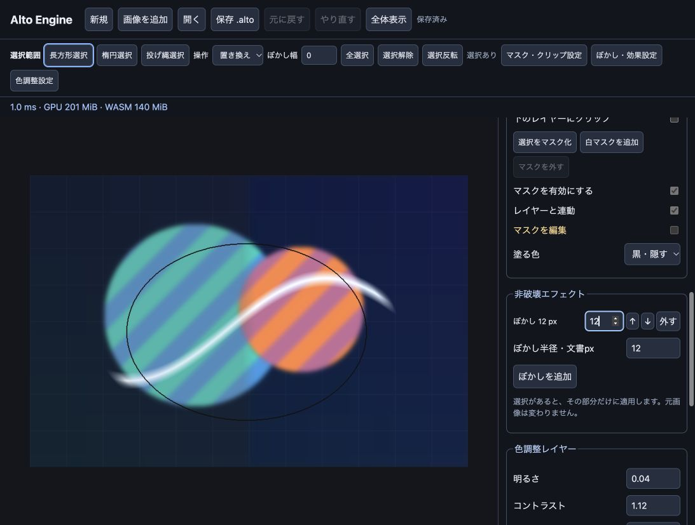

# M5 最終検証結果

生の検証JSONはこのディレクトリに置かない。新しい実行は CI の artifact `alto-browser-reports`（GPU lifecycle の手動実行は `gpu-lifecycle-<OS>`）、ローカルは gitignore した `verification/out/`。以下のかつてのファイル名は、この変更より前の git 履歴にある。

2026-10-18、このMac上で同梱のM5ビルドを検証しました。

## 実装と機能検証

選択範囲（長方形・楕円・投げ縄・追加/削除/共通部分・反転・フェザー）、R8レイヤーマスク、マスクの有効/無効と連動/独立変形、クリッピング、色調整レイヤー、選択範囲付きの非破壊Gaussianぼかし、グループと調整レイヤーを含むROI拡張を実装しました。元のラスター画素は保存し、操作をUndo/Redoできます。

- **Rustテスト22件成功**。選択・マスク・エフェクト参照のGC/保存/ジャーナル保持、不正編集の原子性、タイル境界を越えるフェザー、内容ハッシュの互換性、WGSL検証、既存機能を含みます。
- **内蔵Chromium 155：M5 8項目、M4回帰11項目、B1〜B7すべて成功**。最終同梱ビルドで実施しました。
- native / wasm32のClippyを `-D warnings` で通過。Rust fmtとTypeScriptビルドも成功。
- ぼかしは縦横両方のタイル境界を含む94×94画素をCPUのGaussian参照と比較し、各チャンネル誤差2/255以内。元画像不変、直列エフェクト、選択の固定、グループのhalo、調整レイヤーのぼかしも確認しました。
- 変形レイヤーへの選択付きGPUブラシ、範囲外の隠れたRGB保持と履歴の無変更、マスクブラシのプレビューと正確なUndo、半透明ベースのクリップalpha、調整のグループ範囲/マスク/Multiply合成、ZIP・GPU喪失・Worker再起動・ジャーナル復旧も確認しました。
- UI上で選択範囲のドラッグ、既存ぼかし半径12→19、Undoで12へ復元、M5サンプルの読み込みを確認しました。
- **外部Chrome 154では、途中ビルドのM5 8項目が成功**。最終ビルドの再検証は途中まで確認しましたが、Macの画面ロックで結果JSONを書き出せませんでした。外部ChromeのJSONは途中ビルドの記録です。最終版の合否は内蔵Chromiumの記録を参照してください。

生データ：M5機能（`m5-browser-functional.json`、CI artifact `alto-browser-reports`、ローカルは `verification/out/`）、既存機能の回帰（`m5-browser-m4-regression.json`、CI artifact `alto-browser-reports`、ローカルは `verification/out/`）、性能（`m5-browser-benchmark.json`、CI artifact `alto-browser-reports`、ローカルは `verification/out/`）、UI（`m5-ui.json`、CI artifact `alto-browser-reports`、ローカルは `verification/out/`）、[Rust/SDKログ](m5-rust-and-sdk.log)、Chrome途中ビルド（`m5-chrome-functional.json`、CI artifact `alto-browser-reports`、ローカルは `verification/out/`）。M4時点の結果は [M4-RESULTS.md](M4-RESULTS.md) に保存しています。

## B1〜B7（最終ビルド・内蔵Chromium）

| 指標 | 実測 | 基準 | 判定 |
|---|---:|---:|---|
| B1 パン p95 | 5.9 ms | 16.7 ms | PASS |
| B2 ズーム完了 | 66.4 ms | 250 ms | PASS |
| B3 連続描画 p95 | 5.3 ms | 33.4 ms | PASS |
| B4 全面ストロークUndo | 11.0 ms | 50 ms | PASS |
| B5 保存 / 読込 | 276.4 / 965.0 ms | 3000 / 2000 ms | PASS |
| B6 GPU / WASM | 483.75 / 240.375 MiB | 512 / 1024 MiB | PASS |
| B7 復旧と初回表示 | 1276.8 ms | 1500 ms | PASS |

B7は最初1727.7msで基準を超えました。内容ハッシュの形式を維持したストリーミング計算と、ハッシュ/展開ライブラリの最適化により1276.8msになりました。ハッシュ検証は引き続き行います。最適化前の記録（`m5-browser-benchmark-before-optimization.json`、CI artifact `alto-browser-reports`、ローカルは `verification/out/`）も同梱しています。

### 測定条件と範囲

- 3840×2160、互いに異なる不透明なラスター20レイヤー。背景色とタイルごとの模様がある文書をテスト側で生成します。Normalで完全に隠れた下位レイヤーを省略する最適化が有効です。M5の複雑なエフェクト20層を測った結果ではありません。
- 内蔵Chromium：1093×827 CSS px、DPR 2。SharedArrayBufferなし、`crossOriginIsolated=false`。
- B1：120フレームのパン。Mainのperformance.nowで要求からWorker応答・GPU queue完了まで測ったp95。rAF待機時間は集計外です。
- B2：倍率1→0.5、新レベルの全可視タイルの合成・GPU完了を待ちます。
- B3：直径100pxのブラシを30回連続入力。各入力から表示のGPU処理完了までのp95。2フレームを33.4msとして判定します。
- B4：直径2048pxのブラシで4K全面を通るストロークを確定してからUndo応答まで。
- B5：メモリ上のパッケージ符号化 / Blobからの読込とOPFSチェックポイント書き込みまで。OS保存ダイアログや外部ディスク書込時間は含みません。
- B6：初期表示・描画・全面ストロークのプレビュー/確定後・再読込後をサンプルした最大値。GPUはエンジン管理のテクスチャ/バッファ推計、WASMはlinear memoryの確保量。ドライバーやブラウザー/JS全体のプロセスメモリは含みません。
- B7：WASMキャッシュがある状態でWorkerを再起動し、4K文書の復旧、ハッシュ一致、初回GPU描画完了まで。

付属シナリオでの一回の実測です。異なるGPU、半透明20レイヤー、複雑なグループ、長時間運用の同じ性能を保証しません。GPU timestamp-queryによる個別カーネル時間は測っていません。

## ビルドとサンプル

WASM：2,073,545 bytes、gzip：481,754 bytes（wasm-opt未適用）。SDK v0.2.0 / Worker protocol 2。Mainと2つのWorker、宣言ファイル、WASMを同梱しています。

SHA-256：`da78f8df464f45a64b0ff53dffb2fe5db6e707d5d01e18ac8e61d26a44bb135b`

[`sample-m5.alto`](sample-m5.alto) は768×512、選択範囲、ぼかし付きグループ、クリップしたストライプ、マスク付きペイント、右半分の色調整のサンプルです。新しいネイティブEngineで保存→読込のスナップショット一致を確認し、Playgroundの「M5サンプルを開く」でも表示を確認しました。生成元は `crates/alto-engine/examples/create-m5-sample.rs` です。

## 範囲と制限

- ぼかし/フェザーは0〜64文書px、エフェクトは各ノード32個まで。選択/マスク生成は4096タイル、投げ縄は8192頂点と計算量ガードがあります。
- 色調整は明るさ・コントラスト・彩度。中間描画はRGBA16Fで、GPU間のビット単位一致は保証しません。拡縮サンプリングと完全なcontent mipmapは今後の改善点です。
- 作業ジャーナルはoriginごとに一つで、WebLockで二重起動を拒否します。CPUのcanonical圧縮タイルをOPFSへ退避する機能は未実装です。
- M5文書の表示にはv0.2以降が必要です。外部Chrome最終版、Edge/Firefox/Safariは今回の最終検証対象外です。
- M6（ベクター）、M7（テキスト）、M8（バージョン管理）は後続フェーズです。詳細は [MILESTONES.md](../MILESTONES.md) を参照してください。
