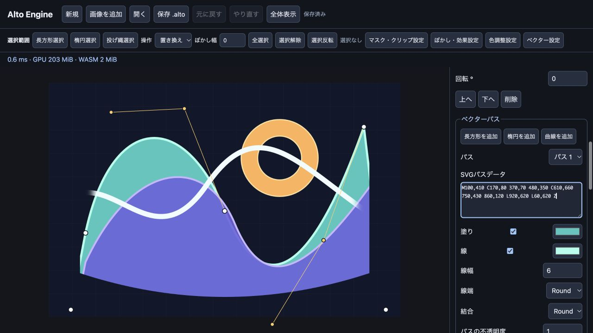

# M6 最終検証結果（M6時点の記録）

2026-10-18〜19、このMac上でM6の同梱ビルドを検証しました。SDK v0.3.0 / Worker protocol 3。

## 実装

ベクターパスの塗り・線・Non-zero/Even-odd、SVGパスデータの変換、端点/制御点とスタイルの編集、ベクターマスク、クリッピングパス、ズームに応じた4x MSAA描画、メッシュキャッシュを追加しました。M5のラスター/グループ/調整マスク・クリッピング・ぼかし、Undo/Redo・`.alto`保存・ジャーナル復旧へ接続しています。

## 合否

- **Rust 26件成功**。f64パスの直列化、可逆Op、不正なパス/マスクの原子的拒否、保存とジャーナル、SVG正規化、曲線テッセレーション、既存機能、8シェーダーの検証を含みます。
- **Chrome 155 / 内蔵Chromium 155：各29項目成功**（M6 10、M5回帰8、M4回帰11）。
- **B1〜B7：両環境ですべて成功**。
- native / wasm32 Clippyを `-D warnings` で通過。比較用vello featureのwasm32 Clippyも通過。Rust fmt、TypeScriptビルドとUI JavaScript構文確認も成功。
- UIで制御点ドラッグ→パス変更、Undoで元の座標へ復元、線幅6→10→Undoで6への復元を確認。[UI記録](m6-ui.json)。
- `sample-m6.alto` は新しいネイティブEngineへ保存/読込してスナップショットとパスの一致を確認。ブラウザーでも読み込んで編集しました。

| 検証 | Chrome 155 | 内蔵Chromium 155 |
|---|---|---|
| M6 10項目 | [JSON](m6-chrome-functional.json) | [JSON](m6-browser-functional.json) |
| M5回帰8項目 | [JSON](m6-chrome-m5-regression.json) | [JSON](m6-browser-m5-regression.json) |
| M4回帰11項目 | [JSON](m6-chrome-m4-regression.json) | [JSON](m6-browser-m4-regression.json) |
| B1〜B7 | [JSON](m6-chrome-benchmark.json) | [JSON](m6-browser-benchmark.json) |

[Rust/SDKログ](m6-rust-and-sdk.log) / [比較用Clippy](m6-comparison-clippy.log) （M6時点のWASMの値は下の「配布物」）。以前の結果は [M5](M5-RESULTS.md)・[M4](M4-RESULTS.md) に保存しています。

## M6の検証内容

1. SVGパス変換と往復、二次/三次曲線、Even-oddの穴とNon-zeroの違い。
2. 線端・結合・半透明の線、自己交差でのalphaの非重複。
3. 制御点/色/変形の編集、正確なUndo/Redoの画素とデータ。
4. 表示レベル -6〜12のうち16段階。解析式 `y=128+(x-256)^2/256` の二次曲線を使い、縦横の表示タイル境界で、曲線から1.2出力px以上離れた内部/外部のalphaを検証。内蔵側で1,435,819サンプルを確認し、境界のMSAA中間alphaも検出しました。文書内に収めるため、縮小側ではレイヤー変形も変更しています。
5. ベクターマスク、0〜64pxのフェザー、R8マスクとの交差、元画像不変。
6. グループと調整へのクリッピングパス/ベクターマスクの積算。
7. ベクターのぼかし、半透明のラスター型クリッピング、親移動へのマスク/クリップ追従。
8. 64倍拡大での選択付きぼかしの外側の鮮明さ、下位内容への調整ぼかし、境界の連続性、64pxフェザーのROI予算。
9. メッシュ再利用、無効なコマンド・座標・線幅・フェザーの拒否と文書不変。
10. パス/マスク/クリップを含むZIP、GPU喪失、Worker再起動とOPFSジャーナルの復旧・画素一致。

テストは付属シナリオの検証で、すべての入力やGPUに対する数学的な保証ではありません。

## 性能B1〜B7

| 指標 | Chrome 155 | 内蔵Chromium 155 | 判定 |
|---|---:|---:|---|
| B1 パン p95 (ms) | 7.10 | 3.90 | PASS |
| B2 ズーム (ms) | 103.10 | 69.80 | PASS |
| B3 連続描画 p95 (ms) | 6.90 | 7.30 | PASS |
| B4 全面Undo (ms) | 10.40 | 11.10 | PASS |
| B5 保存 / 読込 (ms) | 289.20 / 961.60 | 274.50 / 933.90 | PASS |
| B6 GPU / WASM (MiB) | 483.75 / 240.50 | 483.75 / 240.50 | PASS |
| B7 復旧と初回表示 (ms) | 1165.30 | 1116.50 | PASS |

### 条件と範囲

- 3840×2160、互いに異なる不透明なラスター20レイヤー。完全に隠れたNormal下位レイヤーを省略する既存最適化が有効です。M6の大量ベクターや深いエフェクト文書の性能を示す結果ではありません。
- viewportとDPRは各JSONに記録。SharedArrayBufferなし、`crossOriginIsolated=false`。
- B1は120フレームのパン、B3は直径100pxの30連続入力。performance.nowで要求からWorker応答・GPU queue完了まで測り、rAF待機は集計外。B2は倍率1→0.5の可視タイル合成とGPU完了まで。
- B4は直径2048pxで4K全面を通るストローク確定後のUndo応答。B5はメモリ上の符号化 / Blob読込とOPFSチェックポイントまでで、OSの保存先選択や外部ディスクの書込時間を含みません。
- B6は初期表示・描画・ストロークのプレビュー/確定・読込をサンプルした最大値。GPUはエンジン管理のサイズ推計、WASMはlinear memoryの確保量で、ドライバー・ブラウザー・JS全体のプロセスメモリを含みません。
- B7はWASMキャッシュがあるWorker再起動から、4K文書復旧・ハッシュ一致・初回GPU描画完了まで。初回ダウンロードの起動時間ではありません。
- 各環境で一回の実測です。GPU timestamp queryは使用せず、異なる環境や長時間運用の同じ性能は保証しません。

## 描画方式の比較

lyon / velloを同じ100本のパスで実測しました。このwarm描画ではvelloが速い結果でした。AA方式の違い、alpha形式の正規化、初回とwarmの条件、採用判断を [比較レポート](VECTOR-COMPARISON.md) に記載しています。本体はlyon、velloは比較用の別WASMです。

## 配布物

本体WASM 2,532,853 bytes / gzip 599,840 bytes。SDK distとPlaygroundのWASMはバイト一致。SHA-256：`771594873a466c975548563ff083d45163708b055d136cd3380b0b18a45a5409`。

[編集可能なM6サンプル](sample-m6.alto)（960×640）、ソース、ビルド済みSDK/WASM、比較ページ、検証JSON、ライセンス通知を同梱しています。

## 範囲と制限

グラデーション・破線・SVGファイル全体のインポートは未実装。M6の対象はSVGのパスデータと単色の塗り/線です。パス/命令数・メッシュ・GPUメモリには上限があります。詳細は [MILESTONES.md](../MILESTONES.md)。

M6最終版のEdge/Firefox/Safari、異なるGPU、長時間運用・ファジングは未検証。M7のテキスト・日本語縦組み、M8の版管理は後続フェーズです。
