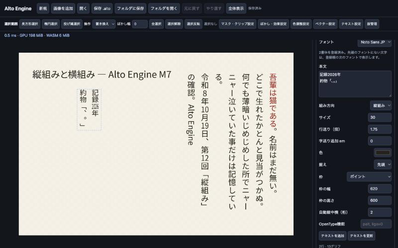

# M7・M8 検証結果

## 2026-10-26：GPUとCPUの画素一致

plain scene の `composite.wgsl` を、f32 の CPU 参照および lavapipe（Mesa 25.2.8）上の同じシェーダと比較した。ロックしたレシピは 34 件（`tests/parity/cpu-reference.txt`）。GPU で比較したのはそれに回転を加えた 35 件で、lavapipe では 33 件が全画素一致した。一致しない 2 件は許容誤差に緩めず、チャネル差が 1/255 を超えたら失敗する明示的な xfail である。

- ビット一致: 17 合成モード、不透明度、非表示、孤立グループとパススルー、入れ子グループ、タイル境界をまたぐ最近傍移動、半画素の平行移動、0/255 とアルファの端、半透明の重ね、8 層、奇数キャンバス、レベル 1 の画素中心。
- xfail `scale-bilinear`: lavapipe で 4906 画素。最初の不一致は pixel 15,0、GPU `[8, 0, 25, 255]`、CPU `[8, 0, 24, 255]`。双一次の `a*(1-t)+b*t` を GPU が縮約する。SwiftShader でもビット一致しない。
- xfail `rotation`（native のみ）: lavapipe で 5 画素。最初の不一致は pixel 43,156、GPU `[50, 123, 177, 255]`、CPU `[50, 123, 178, 255]`。macOS Metal も 1/255 以内で一致しない（CI の `cargo test` はこの xfail があるときだけ通る）。SwiftShader は JS 参照と全画素一致したので、ブラウザ側の xfail は外した。
- 別経路のため CPU 画素参照を持たない xfail: マスク、Gaussian、色調整、ベクター塗り（4x MSAA）、テキスト（グリフアトラスまたはベクター）。
- フレーム待ちはアイドルな遅延表示が 40 回（約 2 秒）を超えると `GPU_LOST` で終わり、デバイスとサーフェスを作り直して次のフレームで文書から再表示する。

`cargo test --workspace --locked` は **123 件**（変更前の記録は 118 件、追加は alto-gpu の 5 件）。Node の SDK テストは 7 件から **11 件**（待ち上限 2 件、CPU 参照のロックステップ 2 件）。ブラウザの parity スイートは 41 件（SwiftShader ではビット一致 34、丸め xfail は `scale-bilinear` の 1 件、別経路 xfail 5、フレーム待ち 1）。macos-15 の機能スイートは functional 32、M5 8、M6 10、M7 9、M8 6、embed 24 が成功し、parity は回転の xfail を外す前に 1 件失敗した。この Linux の SwiftShader は main の配布 SDK でも表示タイルの読み戻しでデバイスが破棄される。最新のブラウザ計測は [フレームペーシング](FRAME-PACING-RESULTS-2026-10-26.md) と [組み込み API](EMBEDDING-API-RESULTS-2026-10-25.md) を参照。

## 2026-10-23：現在の配布版

中断可能な低倍率親タイル先読みを実装した配布WASMは **4,328,183 bytes**、gzip **1,101,543 bytes**、SHA-256 `65d988114c677d07806a7251c315ee33653c4ad7e8d12b3b9adcc8e07e37ea6c`。PlaygroundとSDKの配布バイト列は一致する。Rust94件、SwiftShader機能54件が成功した。Metalの半透明20層・DPR 2負荷テストは5回ともB1/B2/B3/B7を満たし、ズーム前の親タイルは35/35枚だった。最大同期ステップは2.1–2.3 msで、目標2.0 msは厳密には未達。詳細と生データは[中断可能な先読みの検証](RESUMABLE-LOW-ZOOM-PREFETCH-RESULTS-2026-10-23.md)を参照。

## 2026-10-22：縮小表示・復旧高速化後の配布版

WASMは4,281,045 bytes、gzip 1,088,734 bytes、SHA-256 `9e73147b63eacbc17d5bbcf9ebc81b49a331db2834ca5bd8bacdf5a448376992`。PlaygroundとSDKの配布WASMは一致する。Rust94件、SwiftShaderのブラウザ機能17件とM5/M6/M7/M8の33件、MetalのB1–B7を新規Chromeプロファイル3回で確認した。B2は206.1–207.7 ms、B7は1257.9–1282.5 msで各目標内。破損した復旧記録の前世代への復帰、両世代破損時の停止と外部ファイルからの再開を含む。[実装と生データ](PERFORMANCE-IMPLEMENTATION-RESULTS-2026-10-22.md)を参照。

## 2026-10-22：変更前の配布版

固定ツールチェーン（rustc 1.99.1 / wasm-bindgen 0.2.129）とaarch64-apple-darwinのホストでWASMを再生成し、PlaygroundとSDKに同じバイト列を配布しました。CIのバイト比較もarm64 macOSを使用します。本体は **4,313,895 bytes**、SHA-256は `e29c7306aed94d786715d0ccf5f8802b9c75c867e3e0a52287e506f2c0fdbe55`、Node zlibの標準gzipで **1,088,017 bytes** です。[build.json](build.json) の数値は `scripts/check-build-metadata.mjs` で配布ファイルと照合します。

- `cargo test --workspace --locked`：Rust **91件成功**。nativeとwasm32のClippy、SDKビルド、Storage Session単体テスト **7件**も成功。
- 空の`ALTO_TARGET_DIR`からのクリーンビルドも、両配布先と4ファイルすべてバイト一致。`sh scripts/check.sh` の再生成比較、検証記録の照合、ハッシュ一覧の検証も通過。
- Codex内蔵ブラウザ（macOS）で現在の配布版を実行：機能 **13件**、M5 **8件**、M6 **10件**、M7 **9件**、M8 **6件**がすべて成功。機能テストには、ジャーナル追記前の障害と追記後の応答喪失を注入し、編集停止・緊急退避・改訂の復旧を確認する2件を追加しました。
- 従来の**全面不透明**な3840×2160・20ラスター層ではB1〜B7が設定目標を達成。B1描画p95 **4.4 ms**、B2ズーム **147.6 ms**、B3入力から描画p95 **5.1 ms**、B4全面Undo **13 ms**、B5保存/読込 **825.9/1048.4 ms**、B6 GPU/WASMピーク **483.75/240.81 MiB**、B7復旧と初回描画 **1387 ms**。この条件では上位の不透明層が下位の合成を省略できます。B6のGPU上限は512 MiB、B7目標は1500 msであり、余裕は小さい。一回の実測であり、他の端末を保証する値ではありません。
- Storage Workerの起動後障害、読めない応答、無応答は保留要求を `STORAGE` エラーで終了し、書き込みを自動再送しません。応答が失われた書き込みの成否は確定できないため、復旧にはEngine Workerの再起動とジャーナル読み込みが必要です。
- 編集のパッチはジャーナルの書き込み確認後に通知します。保存障害後は編集を停止し、SDKはメモリ内の `.alto` 退避と確認済みジャーナルからの復旧を提供します。Playgroundでは退避・復旧ボタンを表示します。復旧結果と障害前の表示のハッシュが違う場合は通知します。
- CI用のChrome自動検証では機能13件、M5 8件、M6 10件、M7 9件、M8 6件がこのMacで成功しました。SwiftShaderのソフトウェアWebGPUでも同じ5スイートが成功しました。GitHub Actionsの[初回実行](https://github.com/NobukiAkiyama/alto-engine/actions/runs/39637396693)（`bef3903`、macos-15 arm64、Chrome/SwiftShader）でも `scripts/check.sh` と5スイートが成功し、保存された結果JSONで13/8/10/9/6件・失敗0を確認しました。性能B1〜B7はCIの合否条件ではなく、上記の数値はこのMacでの実測です。

## 2026-10-22：半透明20層の負荷テスト

各層の全面塗りをalpha 0.5に変更し、模様はalpha 0.45で重ねました。これにより下位層も合成される条件で、同じ4K・20層のB1〜B7をこのMacのHeadless Chrome 155 / Metal（1280×657、DPR 1）で3回実行しました。[1回目](translucent-benchmark-2026-10-22-1.json)・[2回目](translucent-benchmark-2026-10-22-2.json)・[3回目](translucent-benchmark-2026-10-22-3.json)の生JSONを保存しています。

| 指標 | 3回の結果 | 目標 | 判定 |
|---|---:|---:|---|
| B1 描画p95 | 3.8 / 3.5 / 4.1 ms | 16.7 ms | 3回成功 |
| B2 ズーム | 364.2 / 393.2 / 394.6 ms | 250 ms | **3回失敗** |
| B3 入力から表示p95 | 21.1 / 21.0 / 24.0 ms | 33.4 ms | 3回成功 |
| B4 全面Undo | 10.0 / 10.1 / 9.8 ms | 50 ms | 3回成功 |
| B5 保存 / 読込 | 813.9–818.9 / 812.8–821.8 ms | 3000 / 2000 ms | 3回成功 |
| B6 GPU / WASM計上値 | 483.75 / 240.94–241.13 MiB | 512 / 1024 MiB | 3回成功 |
| B7 復旧と初回表示 | 2012.1 / 2027.6 / 2016.1 ms | 1500 ms | **3回失敗** |

B6はエンジンが計上する割当量を描画時にサンプリングした値で、ブラウザ全体の実VRAM使用量や瞬間的な最大値ではありません。性能はCIの合否条件ではありません。従来の不透明層の数値を、半透明層を多用する制作物の余裕として扱わないでください。

以下のJSON、画像、細かな画素比較およびHeadless Chromeの数値は、**2026-10-21時点の旧配布版**の記録です。今回のブラウザ操作結果をそれらのファイルに上書きしていません。

## 2026-10-21：旧配布版の記録

2026-10-21、当時のソースから作り直した WASM と SDK を、この Mac 上で検証しました。SDK v0.4.0 / Worker protocol 4。Playground の `pkg` と SDK の `dist/pkg` は同じバイト列でした。

## 合否

- **Rust 68件成功、失敗 0。** `alto-core` 3、`alto-doc` 11、`alto-engine` 16、`alto-git` 1、`alto-gpu` 10、`alto-raster` 2、`alto-store` 3、`alto-text` 20（単体 4 と `tests/layout.rs` 16）、`alto-vector` 2。[ログ](rebuild-rust.log)
- `cargo fmt --all -- --check`、native と wasm32 の Clippy `-D warnings`、SDK の TypeScript ビルドを通過。2026-10-19 の記録は [ログ](m78-rust-and-sdk.log)。
- **Headless Chrome 155.0.8059.84：機能 11項目、M5 8項目、M6 10項目、M7 9項目、M8 6項目、B1〜B7、すべて成功。** `node scripts/verify-browser.mjs` が、配布している WASM を配信する Playground に対して実行しました。

| 検証 | 結果 |
|---|---|
| 機能 11項目 | [JSON](rebuild-functional.json) |
| M5 8項目 | [JSON](rebuild-m5.json) |
| M6 10項目 | [JSON](rebuild-m6.json) |
| M7 9項目 | [JSON](rebuild-m7.json) |
| M8 6項目 | [JSON](rebuild-m8.json) |
| B1〜B7 | [JSON](rebuild-benchmark.json) |
| `alto-git` の実行記録 | [テキスト](m8-git-transcript.txt) |

2026-10-19 の内蔵 Chromium 152 の JSON は、その日の別バイナリ（SHA-256 `68b14862c40be81523462ad90fbb86acd876b1bcff5548055a2125c971b0481d`）の記録として残しています。M6までの経緯は [M6](M6-RESULTS.md)・[M5](M5-RESULTS.md)・[M4](M4-RESULTS.md)。

## M7の検証内容

完了条件「日本語の縦組みで約物と縦中横が正しく配置される」を、GPUで描いた表示タイルの画素で確認しました（100pxの文字、列の幅150px・中心から右が右半分）。下表の座標は 2026-10-19 の計測です。2026-10-21 のビルドでは同じ9項目が成功し、合否は [rebuild-m7.json](rebuild-m7.json) にあります。

| 対象 | インクの範囲（セル内の座標） | 判定 |
|---|---|---|
| 。（縦組み） | x 140–170（列の中心125より右）、セル上端から6–37px | 右上 |
| 、（縦組み） | x 141–169、セル上端から6–33px | 右上 |
| 「（縦組み） | セル上端から65–97px | セルの下側 |
| ー（縦組み） | 幅10px × 高さ78px | 縦棒 |
| 。（横組み・対照） | 文字の左下 | 左下 |
| 縦中横「12」 | 1em（100px）内に2桁、列の中心±6px | 1マス |
| 指定範囲「2026」 | 96px幅に圧縮 | 1em以内 |
| 「123」（自動対象外） | 高さ151px × 幅74px | 回転 |

1. フォント取り込み（名前・縦組み対応・不正データ拒否）、フォールバック順、表示できない文字の報告、フォントの無い文字の仮の枠、使用中フォントの削除拒否。
2. 縦組みの句読点・括弧・長音の位置（上表）。Rustテストでは、vertを持たないフォントの代替配置がNoto Sans JPの縦組み字形と15/100em以内で一致することも確認しています。
3. 縦中横：自動（2桁）、指定範囲の1em圧縮、3桁の回転。
4. 縦組み中の欧文の回転、palt（500→341.5px）・fwid（全角幅）・ligaの有無。
5. 選択：ヒットテスト・キャレット・選択矩形・行移動を、拡大・移動したレイヤーの文書座標で検証。サロゲートペア（𠮷）の前後移動、縦組みの列移動。
6. 編集：範囲置換、範囲の色、spanの移動、Undo/Redoの画素一致、不正なspanの拒否。
7. ズーム：表示レベル-4・-2・0・2で、内側が不透明かつ輪郭に中間アルファがあること。
8. `.alto` 往復・Worker強制終了とジャーナル復旧・GPUデバイス喪失後の画素一致。
9. 小さな文字のグリフアトラス：12pxの横組み（40pxのspanを含む1レイヤー2サイズ）、10pxの縦組み（括弧・縦中横）、30°回転した11pxの横組みを、アトラスあり・なし（`unstable.setGlyphAtlas`）で同じ表示タイルに描いて比較。

   | レイヤー | インク量 アトラス / ベクター | 重なり Σmin/Σmax | 平均差 | 行・列投影の相関 | インク範囲 |
   |---|---|---|---|---|---|
   | 横組み12px | 658.2 / 651.9（+1.0%） | 0.86 | 0.073 | 0.998 / 0.997 | 一致 |
   | 縦組み10px | 192.9 / 191.8（+0.6%） | 0.80 | 0.084 | 0.987 / 0.999 | 一致 |
   | 回転11px | 316.2 / 317.0（−0.3%） | 0.76 | 0.106 | 0.981 / 0.981 | 一致 |

   許容差はインク量±4%、重なり0.7以上、平均差0.15未満、相関0.97以上、範囲±1px。ベクター側は4x MSAAで被覆が1/4刻み、アトラス側は面積被覆のため、1px幅の線では画素ごとの差が残ります。49字がアトラス、40pxのspanはベクター経路でした。表示レベル-2（12px→48px）では両方式の画素が完全一致（全ランがベクター）、レベル1（6px）では再びアトラスを使用。結果は決定的で、GPUデバイス喪失後もアトラスを描き直して同じ画素になります。

PlaygroundのUIでも、テキストツールのドラッグ選択→入力→Backspace→キャレット表示、M7/M8サンプルの表示を確認しました。

## M8の検証内容

完了条件「フォルダ形式をgitで管理でき、差分がレイヤー単位で読める」を、ブラウザと実際のgitで確認しました。

1. コミット、Intent要約（ブラシ3回→Undo1回で「Brush stroke ×2（線画）」）、履歴、作業中の変更数、変更の無いコミットの拒否、コミット後の未保存状態。
2. 意味的差分：版間の「線画：4タイル (0,0)–(512,512)」「背景：opacity」、作業中の「人物を追加」「線画を人物へ移動」。移動は画素変更として報告しません。
3. 版の復元を1回のUndoで戻せる編集として適用し、画素と文書が一致。履歴は書き換えない。
4. `.alto` を開き直しても履歴が残り、古い版を復元できる（履歴のタイルを保持）。
5. OPFS上のフォルダ形式：初回9ファイル、2回目は新規2・既存9（増分）。manifestのhead、`document.json` が行単位のJSONであること、フォルダからの読み込み、復元、他者がmanifestを書き換えた後の保存をCONFLICTで拒否し何も上書きしないこと。メモリ実装でも往復。
6. コミット直後のWorker強制終了でもコミットと画素が残ること。

`alto-git` は、`sample-m78.alto` をフォルダ形式へ展開し、新しいgitリポジトリへ3つのAltoコミットを3つのgitコミットとして写しました（[記録](m8-git-transcript.txt)）。`git status` は空、`git fsck --strict` 成功、2回目の `sync` は「最新」。コミットメッセージ・`alto-git log`・`alto-git diff HEAD~2:… HEAD:…` はレイヤー単位で変更を表示し、textconvを登録した `git diff` は `[raster] 紙 … opacity=0.92` や追加された `[text] 注記` の行として差分を示します。Rustの統合テストでは、追加の版で新しいオブジェクトが1つだけコミットされること、`.alto`⇔フォルダの往復で履歴が残ることも確認しています。

## 性能B1〜B7（2026-10-21 のビルド）

| 指標 | Headless Chrome 155 | 目標 | 判定 |
|---|---:|---:|---|
| B1 パン p95 (ms) | 3.20 | 16.7 | PASS |
| B2 ズーム (ms) | 9.60 | 250 | PASS |
| B3 連続描画 p95 (ms) | 4.50 | 2フレーム | PASS |
| B4 全面Undo (ms) | 11.80 | 50 | PASS |
| B5 保存 / 読込 (ms) | 844.0 / 999.1 | 3000 / 2000 | PASS |
| B6 GPU / WASM (MiB) | 483.75 / 240.81 | 512 / 1024 | PASS |
| B7 復旧と初回表示 (ms) | 1094.9 | 1500 | PASS |

条件はM6と同じ（3840×2160、不透明な20ラスターレイヤー、SharedArrayBufferなし、一回の実測）。ビューポートは1280×657 CSS px・DPR 1です。テキストや多数の版を含む文書の性能を示す結果ではありません。2026-10-19 の内蔵 Chromium 152 での数値は、別バイナリの [記録](m78-browser-benchmark.json) です。

## 検証中に見つけて直したこと

- **入れ子のWorker**：内蔵Chromium 152ではEngine WorkerからStorage Workerを起動できず、初期化が応答なしで止まっていました。Storage Workerが起動・応答しない場合、同じOPFSジャーナル処理をEngine Worker内で実行するようにしました（`storage-core.js` を共有）。
- **SDKの要求ID**：要求本体の `id` がペイロードで上書きされ得る構造でした。要求IDを最後に設定し、テキストAPIはノードIDを `node` で渡すようにしました。
- **縮小表示のタイル数（B7）**：表示キャッシュが空の状態でキャンバス端の表示タイルを縮小合成すると、キャンバス外のタイルが無いために「不透明な上位で下位を省略」が効かず、アトラス（512枠）を超えていました。合成範囲をキャンバス内に限定しました（合成シェーダーはもともとキャンバス外を描きません）。
- Playgroundの「全体表示」が、再起動直後のまだ寸法の無いcanvasで倍率を計算しないようにしました。

## 配布物

2026-10-21時点の本体WASMは4,162,722 bytes / gzip 1,047,959 bytes。SDK distとPlaygroundのWASMはバイト一致。SHA-256：`51e7fdee1480eedc1699ac8f525442131f22c470f178a3fb826e7d50e21f8832`。

比較用の `examples/vector-comparison` は今回ビルドしていません。4,223,713 bytes / gzip 984,224 bytes。SHA-256：`a1a29fb3596f6361e170e760f5c14604b5b172cf6256fbaac798e20ac51c899b`。

切り抜き、スタンプ、レベル補正、カーブ、色相、反転などの画像編集操作は Rust API にあります。WASM のコマンドにはしておらず、ブラウザへ配るプロトコルは 4 のままです。

[M7/M8サンプル](sample-m78.alto)（1200×800、縦組み本文・横組み見出し・縦中横の注記、OFLのテスト用フォント2書体を埋め込み、3版の履歴）。テスト用フォントは `tests/fonts/`（Noto Sans JP / Noto Sans のサブセット、SIL OFL 1.1）。

テストは付属シナリオの検証で、すべての入力・フォント・GPUに対する保証ではありません。範囲と制限は [MILESTONES.md](../MILESTONES.md) を参照してください。
